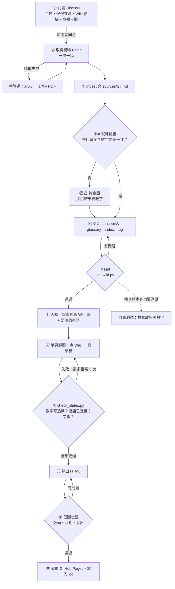

# Loop / Graph 設計

## 流程圖（v2，實際執行後修改過的版本）

## 每個節點做什麼

| 節點 | 輸入 → 輸出 | 誰做 | 檢查方式 |
|---|---|---|---|
| ① 討論 | 作業需求 → 來源清單、大綱 | AI 提案、**人類確認** | 人工 |
| ② 取得 | URL → 原文內容 | AI（WebFetch） | 讀不到就換管道 |
| ③ Ingest | 原文 → `sources/S#.md` | AI | ③-a 書目／數字一致性 |
| ④ 整理 | 來源頁 → 概念頁、術語表 | AI | — |
| ⑤ Lint | 整個 Wiki | `lint_wiki.py` | 引用存在、連結有效、無孤兒頁、**概念頁數字必須出現在引用的來源頁** |
| ⑥ 大綱 | Wiki → 15 頁大綱 | AI | 每頁要有 `data-wiki` |
| ⑦ 草稿 | 單頁大綱 + Wiki 頁 → HTML 投影片 | AI | — |
| ⑧ 單頁檢查 | 投影片 | `check_slides.py` | 數字邊界比對、術語 `<dfn>`、字數 ≤ 330 |
| ⑨⑩ 輸出與截圖 | HTML → 15 張截圖 | Playwright | 溢出偵測 + 人眼看截圖、測互動 |

## 哪些步驟會重複？
- **② ~ ④ 每篇來源跑一次**（6 次）。
- **⑤ Lint ↔ ④ 整理**：直到 0 錯誤。
- **⑦ ↔ ⑧ 每張投影片一個迴圈**：檢查失敗就回到草稿重寫，最多 3 次，超過就回到 ⑥ 改大綱。
- **⑨ ↔ ⑩**：版面問題修到截圖沒有問題為止。

## 哪些地方需要檢查或重新生成？
- ③-a：論文本身的數字矛盾 → 不重新生成，而是**標註 + 選定一個版本**。
- ⑤：概念頁的數字找不到來源 → 回到 ④ 修改概念頁。
- ⑧：數字無法追溯、術語未解釋、字太多 → **重新生成該頁**。
- ⑩：版面重疊、互動壞掉 → 改 CSS／JS，不改內容。

## 為什麼這樣設計？
1. **「先討論、後生成」**：主題和來源由人決定，AI 不會自己挑方便的資料。
2. **Wiki 是唯一事實來源**：簡報只能用 Wiki 的數字，所以檢查可以自動化（比對文字即可）。
3. **檢查越早越便宜**：Ingest 時抓到的錯只要改 1 頁；到了簡報才發現，要改來源頁、概念頁、投影片 3 個地方。
4. **檢查器也要被檢查**：自動檢查會給人「已經檢查過」的錯覺，所以要用故意放錯的資料測試它。

## v1 → v2 改了什麼（實際執行後）
| 改動 | 原因（見 run-log.md） |
|---|---|
| ③ 後加入「就地檢查」③-a | S1 原文數字自相矛盾、3 篇缺發表場合，若等到簡報才發現會擴散 |
| ⑤ Lint 加入「數字回溯」與標題引用繼承 | 第 1 次 lint 漏掉寫在標題的引用 |
| ④ 新增 glossary.md，⑧ 改讀它 | 第 1 次簡報檢查有 9 個術語沒解釋 → 檢查往前移到 Wiki |
| 新增「檢查器自我測試」 | 數字比對用子字串，「20」因「2020」誤判通過 |
